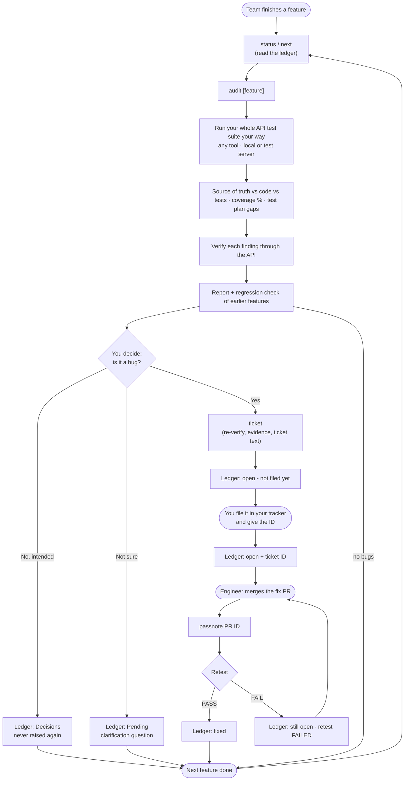
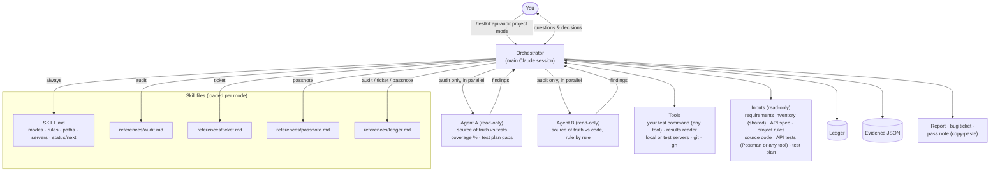

# API Audit

`api-audit` helps you test a service's **API** feature by feature, as the team delivers them. For each finished feature it compares three things: the source of truth (requirements, acceptance criteria, API spec, business rules), the implementation, and the API tests (a Postman collection, or tests in any tool that writes JUnit XML). It also writes bug tickets and fix pass notes for your issue tracker for you to copy and paste.

It doesn't cover UI display or help text.

## Install

This skill is part of the `testkit` plugin. See [Install](../../../../README.md#3-install) in the main README.

The examples below use `/testkit:api-audit` and a made-up `orders-service` with the features create order, payment and refunds.

## Project rules (optional)

To set them up, see [Project rules](../../../../README.md#project-rules) in the main README. This skill uses your folder layout, local start command, domain glossary and business rules, units and formats, and ticket format. Without project rules, it searches the project, uses generic defaults and says that no project rules were found.

---

## The flow



The `status / next`, `audit`, `ticket` and `passnote` boxes are modes of `/testkit:api-audit <project> …`. The ledger is what links one run to the next.

---

## How it works (skill, orchestrator, agents)

`api-audit` is a **skill**: a set of instructions, not a workflow script or a custom agent. When you run it, the Claude session you're chatting with becomes the **orchestrator**. It reads only the files the chosen mode needs, does the work, and in audit mode hands two read-only research jobs to **sub-agents**.



### Who does what

| Part | Role | Can write files? | Talks to you? |
|---|---|---|---|
| **Skill** (SKILL.md + references) | The instructions. Only the files for the chosen mode are loaded | — | — |
| **Orchestrator** (main session) | Runs every mode: setup, servers, test runs, verifying each finding, the three-way comparison, reports, tickets, pass notes, ledger | Yes: ledger, evidence, work files and backups (all in `Testkit/api-audit/`), and your tests only after your go-ahead | Yes, it asks every question |
| **Agent A** (audit only) | Takes the feature's requirements from the shared inventory, adds the edge cases, and maps them and the test-plan scenarios to your API tests. Returns coverage %, gaps and suspected test bugs | No (read only) | No |
| **Agent B** (audit only) | Compares the feature's requirements (from the inventory) and the API spec with the code, rule by rule. Returns mismatches and ambiguities | No (read only) | No |

### Sub-agents per mode

| Mode | Sub-agents |
|---|---|
| `status` / `next` | 0 |
| `audit` | 2 (A and B, in parallel) |
| `ticket` | 0 |
| `passnote` | 0 |

### Design choices

- **Agents research, the orchestrator decides.** Agent findings count as "unverified" until the orchestrator confirms them in the code, the source of truth and the API.
- **One writer.** Only the orchestrator writes the ledger, evidence and ticket text, so there's never more than one version of the state.
- **You stay in the loop.** Bugs, accepted side effects and test changes all go through you. Nothing is committed or pushed.
- **Lean loading.** A status run reads only SKILL.md. Each other mode adds just its own reference file and the ledger rules.

---

## Step 1: Check where the project stands

```
/testkit:api-audit orders-service status
```

This is read-only and safe to run any time: it doesn't touch your checkout (it compares with main through GitHub, or in its own separate copy). For a **new project** it says there's no ledger yet and suggests an audit.

## Step 2: Audit the first finished feature

```
/testkit:api-audit orders-service audit
```

When you don't name a feature, it:
1. Lists the features from the requirements, the API spec and the code, and **asks you which ones are finished**. Tick only what the team has delivered.
2. Shows the inputs it found (requirements, spec, code, API tests, test plan). Confirm them.
3. Runs your whole API test suite the way your team does (your test command in any tool, or newman for a Postman collection), restarting the servers first if they're local, and compares source of truth vs code vs tests for that feature.
4. Gives you a report with:
   - implementation bugs
   - clarification questions
   - coverage gaps, with coverage % against the test plan and against the rules
   - test plan gaps: rules and edge cases the test plan doesn't list (for you to add to the plan; the skill never edits it)
   - test bugs in your API tests
   - checks that wait on unbuilt features ("pending")

It doesn't change any repo file. Its working files go to `~/Desktop/Testkit/api-audit/work/<project>/`.

## Step 3: Decide on each bug

For every confirmed bug it asks you:

| Your answer | What happens |
|---|---|
| **Yes, it's a bug** | It writes the ticket (Step 4) |
| **No, it's intended** | Saved as a decision and never raised again |
| **Not sure** | Saved as a question for the engineers or product |

Nothing becomes a ticket without your yes.

## Step 4: File the ticket

After your yes, it re-checks the bug on the latest main and saves JSON evidence in `~/Desktop/Testkit/api-audit/bug-evidence/<project>-bug-<slug>-json/`. Then it writes the ticket for you to copy.

1. Copy the ticket into your tracker and attach the evidence files it lists.
2. **Tell Claude the ticket ID** (e.g. "filed as SHOP-1234"). Until you do, the ledger shows `open — not filed yet`.
3. Optional: say yes when it offers a test (in your API test tool) that asserts the correct value. That test fails on purpose until the fix lands.

You can also write a ticket directly, without an audit:
```
/testkit:api-audit orders-service ticket "refunds: a refund larger than the payment is accepted"
```

## Step 5: Verify the fix when the PR is merged

```
/testkit:api-audit orders-service passnote <PR number> <ticket ID>
```

It builds main with the fix, reruns the repro and the whole test suite, and saves fresh evidence in `~/Desktop/Testkit/api-audit/fix-evidence/`. Then it writes the ticket comment:
- **PASS:** copy it into the ticket. The ledger marks the ticket `fixed`.
- **FAIL:** copy it into the ticket. It stays open, and you run passnote again on the next fix PR.

If the fix changes some other behaviour, it asks you whether that's accepted before writing PASS.

## Step 6: Next feature, next sprint

When the team finishes another feature:
```
/testkit:api-audit orders-service audit payment
```

Each audit also re-checks the features audited before (regression), and the pending checks that were waiting on this feature.

Not sure what to do next? Run:
```
/testkit:api-audit orders-service next
```
It recommends one step and asks before running it.

---

## Example sprint plan

| Sprint | Team delivers | You run |
|---|---|---|
| 1 | Create order | `audit` → answer each bug → file tickets → give the ticket IDs |
| 2 | Payment + create-order fixes | `passnote <PR> <ID>` for each fix, then `audit payment` |
| 3 | Refunds | `audit refunds` (also re-checks create order and payment) |

## The ledger

Each project has one file, `~/Desktop/Testkit/api-audit/feature-audit/<project>/ledger.md` (the folder can be changed with the output folder in the project rules). It's the skill's memory between sprints:
- features audited, with the date, spec version, code commit and coverage %
- your decisions
- tickets and their status (`open — not filed yet` → `open` → `fixed` or `still open — retest FAILED`)
- tests that fail on purpose
- pending checks

The first audit creates it. You can read it, but let the skill update it.

## Good to know

- **Nothing is committed or pushed.** If it changes your tests (only after your go-ahead, with a backup), you review and commit them yourself.
- Your own checkout is never pulled or switched. Main is tested in a separate copy in `~/Desktop/Testkit/api-audit/work/<project>/main/`.
- **It reuses the requirements other skills read.** If you ran `api-test-plan` (or `read-requirements`, `create-testcase`) for the same project and the documents haven't changed, the audit uses that saved inventory, and finds your test plan in `~/Desktop/Testkit/api-test-plan/<project>/` automatically.
- **Test backups are kept** in `~/Desktop/Testkit/api-audit/backups/<project>/`, so they survive a restart.
- Tickets and pass notes contain no code. They explain everything with API evidence and the source of truth (document and section).
- **Any API test tool.** It reads results from any tool that writes **JUnit XML** (most do), or newman's JSON for Postman, with the plugin's results reader, so the audit works the same either way. It works out which tool you use from your test files (or the `API test tool` line in project rules), confirms it with you, and names it with its version in the report, the ledger, bug tickets and pass notes (e.g. "Bruno 1.20", "Postman / newman 6.2.3"). If your command already writes a report, set `API test results` in project rules. When it adds or fixes tests (only if you ask), it writes them in your own framework and style, and never adds a new tool or library.
- **Your setup, your way.** The audit runs your own API tests and environment as they are, in any tool (Postman, Bruno, Insomnia, REST Assured, Karate, pytest, Jest, Playwright, k6…): local servers, a shared test server, or your team's own command (set `API test command` in project rules). Before running, it lists the hosts the environment uses. Hosts other than `localhost` or the `Test hosts` in your project rules need your OK once per session, and it never runs against production.
- If something looks wrong in a result on local servers, restart them and rerun. Stale server state is the most common cause. On a shared test server, leftover data from other testers can be the cause.

## Troubleshooting

| Problem | Fix |
|---|---|
| "Port in use" or requests don't send | Something else is on the API port. Stop it, or let the skill restart the servers |
| It can't find the project or its docs | Add the folders to the project rules, or give the full path in the request |
| Requirements are in a tool it can't read | Export them as Markdown, text or CSV into the requirements folder, or paste them in |
| No API spec | Fine. It uses the requirements and project rules only, and says so |
| No API tests yet | Fine for an early sprint. Coverage shows "Missing", and it offers to write the feature's tests |
| `gh` errors | Run `gh auth login` |
