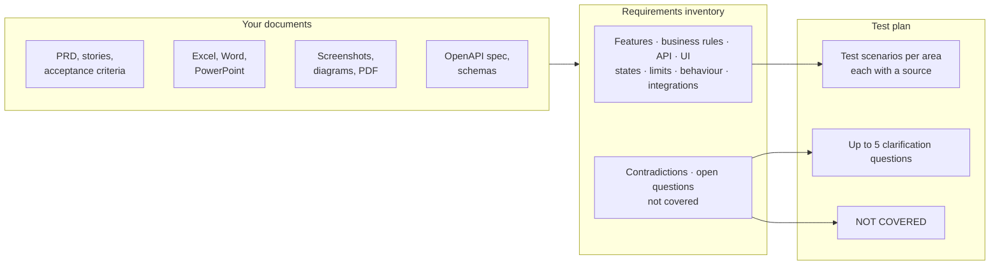

# api-test-plan

Generate a structured API / server-side test plan for a feature or service from its source documents.

## Overview

The skill reads the documents that define a feature (PRD, user stories, acceptance criteria, OpenAPI or JSON schema, design docs, business-rule tables) and writes a QA test plan **before or while** the code is written. Two agents run in sequence: the first builds a cited inventory of the requirements, the second turns it into edge and negative cases. Every test cites its source. Gaps and conflicts become clarification questions, not guesses.

## Install

This skill is part of the `testkit` plugin. See [Install](../../../../README.md#3-install) in the main README.

**Project rules (optional):** see [Project rules](../../../../README.md#project-rules) in the main README. This skill uses the requirements folder, API spec path, glossary and business rules, units, test tags, terminology and output folder. Without project rules it uses generic defaults and says so in the test plan.

## What to provide

| Document | Needed? | Examples |
|---|---|---|
| **Requirements** | **Required** | PRD, user stories, acceptance criteria, business-rule tables, design docs |
| **API spec** | Optional, recommended: gives exact field names and status codes | OpenAPI / Swagger (`openapi.yaml`) |
| **Schemas** | Optional | JSON Schema files (`*.schema.json`) |

Put them in **one of two places**:

1. **The default folder `~/Desktop/Testkit/qa-docs/`.** Good if you don't have repo access. Use one subfolder per project (e.g. `qa-docs/orders-service/`): every testkit skill looks there first. Spec and schema files can sit in the same folder: the skill recognises them.
2. **Your own repo:** pass a path (`docs/orders-prd.md`) or a GitHub link (`https://github.com/<owner>/<repo>/tree/main/docs`). Links are read with `gh`, read-only, so you need `gh` signed in to an account that can see the repo.

**File types:** PDF, Word, Excel, PowerPoint, Markdown, CSV, screenshots and more. See [Which files can I use?](../../../../README.md#which-files-can-i-use) in the main README (also for Confluence, Google Docs and Figma).

## Reading the requirements

The skill first asks for the **project name**. It saves what it read in `~/Desktop/Testkit/requirements/<project>/`: a cited requirements inventory, the list of source files, and readable copies of Office files. If you already ran `read-requirements` or `create-testcase` for the same project and the documents haven't changed, it offers to reuse that instead of reading again. See [How they work together](../../../../README.md#testkit).

## Usage

```
/testkit:api-test-plan [<docs path | GitHub link>] [spec=<openapi/schema paths or links>] [html] [grill] [rules=<path or link>]
```

- First value: a file, folder or GitHub link with the requirements. Without it, the skill offers the files this project used last time, otherwise looks in `~/Desktop/Testkit/qa-docs/<project>/`. When it found the files itself, it lists them and asks before going on.
- `spec=` — API spec and schemas, when they're not with the documents. Files, folders or links, comma-separated.
- `html` — also write the interactive HTML checklist.
- `grill` — run a 10-question self-review after writing the plan.
- `rules=` — your project rules file, if it's not in the usual place: a path or a GitHub link. Optional. See [Project rules](../../../../README.md#project-rules).

Examples:
```
/testkit:api-test-plan
/testkit:api-test-plan docs/orders-prd.md spec=openapi.yaml,schemas/ html grill
/testkit:api-test-plan https://github.com/acme/orders-service/tree/main/docs
```

Markdown is always written. HTML and self-review only when asked.

## How properties are chosen

- **Spec given:** response fields come from the spec, marked `Properties (<spec file>)`.
- **Field named only in the docs:** marked `Properties (docs)`, with a ⚠️ "Not in spec — confirm with engineer" note.
- **No spec:** fields come from the docs only, with one ⚠️ note at the top of the plan.
- A field that neither the docs nor the spec name is never added.

Every API is also checked against a list of standard areas (validation, auth, state, errors, idempotency, concurrency, pagination, rate limits…). A check becomes a test only if the documents define the behaviour. If they're silent and it matters, it becomes a question; otherwise it's listed under NOT COVERED.

## Outputs

Saved to the output folder (project rules override, default `~/Desktop/Testkit/api-test-plan/`), never into the source repo:

```
<output folder>/<project>/
├── <project>-api-test-plan.md      (always, TSV for spreadsheets)
└── <project>-api-test-plan.html    (only if requested, interactive checklist)
```

### Markdown (TSV)
Tab-separated, pastes straight into a spreadsheet. Columns: Status, Test Scenario, Verification / Note, Source, Tags. `⬅️` = assertion, `💡` = note or open point.

Sections: header (sources, project rules used), Feature Map, Automated Tests, one section per test area the docs support, Questions for Clarification (max 5), and NOT COVERED (doc sections and standard checks that were skipped, with reasons).

### HTML (interactive)
Dark by default, with a light/dark toggle. Summary cards, progress bar, search (`/` shortcut), tag filter pills (from project rules "Test case tags"; default smoke, regression), Unchecked Only, Expand/Collapse All, checkboxes saved in localStorage, PENDING REVIEW / REVIEWED badge.

## Flow

```mermaid
flowchart TD
    Start(["/testkit:api-test-plan"]) --> Name["Ask for the project name<br/>e.g. orders-service"]
    Name --> Where{"Where are<br/>the documents?"}
    Where -->|"path or GitHub link given"| Found["Read those files"]
    Where -->|"nothing given"| Last{"Files this project<br/>used last time?"}
    Last -->|"yes"| Confirm{"Use these files?"}
    Last -->|"no"| Default["Look in ~/Desktop/Testkit/qa-docs/PROJECT/<br/>then the project rules requirements folder"]
    Default --> Confirm
    Confirm -->|"no"| AskPath["Ask for a path or link"] --> Found
    Confirm -->|"yes"| Found
    Default -->|"nothing found"| AskPath
    Found --> Spec["Detect the API spec and schemas<br/>openapi.*, swagger.*, *.schema.json, or spec="]
    Spec --> Finger["Fingerprint the files"]
    Finger --> Saved{"Saved requirements for this<br/>project, files unchanged?"}
    Saved -->|"yes"| Reuse{"Reuse them?"}
    Reuse -->|"yes"| AgentB
    Reuse -->|"no"| Office
    Saved -->|"no, or files changed"| Office{"Excel, Word or<br/>PowerPoint files?"}
    Office -->|"yes"| Convert["Convert them<br/>(you approve the command)<br/>sheets → CSV, docs → Markdown, pictures → images"]
    Office -->|"no"| AgentA
    Convert --> AgentA["Agent A: requirements-analyst (read only)<br/>reads everything, focus = api<br/>→ cited requirements inventory"]
    AgentA --> SaveInv[("~/Desktop/Testkit/requirements/PROJECT/<br/>inventory + sources + converted files")]
    SaveInv --> AgentB["Agent B: doc-reader (read only)<br/>edge cases and negative paths<br/>from the inventory only"]
    AgentB --> Write["Write the test plan<br/>Markdown always, HTML if asked"]
    Write --> Out[("~/Desktop/Testkit/api-test-plan/PROJECT/")]
    Out --> Grill{"grill?"}
    Grill -->|"yes"| Review["10-question self-review<br/>one at a time, plan updated live"] --> Done(["Done"])
    Grill -->|"no"| Done
```



### From documents to test plan



### Agent A: requirements analyst
The shared `testkit:requirements-analyst` agent, also used by `create-testcase` and `read-requirements`. It extracts everything the documents say (UI and API) so the inventory can be reused, and with focus `api` it also checks every field, limit and status code against the spec. UI-only rules go to NOT COVERED unless they imply API behaviour (e.g. "button disabled after 3 attempts" → the API rejects a 4th).

### Agent B: edge case and negative path specialist
Works from the inventory, not the raw docs, and walks the standard API checks (see "How properties are chosen" above), only where the docs support them.

## Key rules

- The documents and spec are the only source of truth. Every test has a source.
- No invented fields, codes or limits. Unclear → question.
- Expectations never come from the implementation code.
- Areas the docs don't support are left out.
