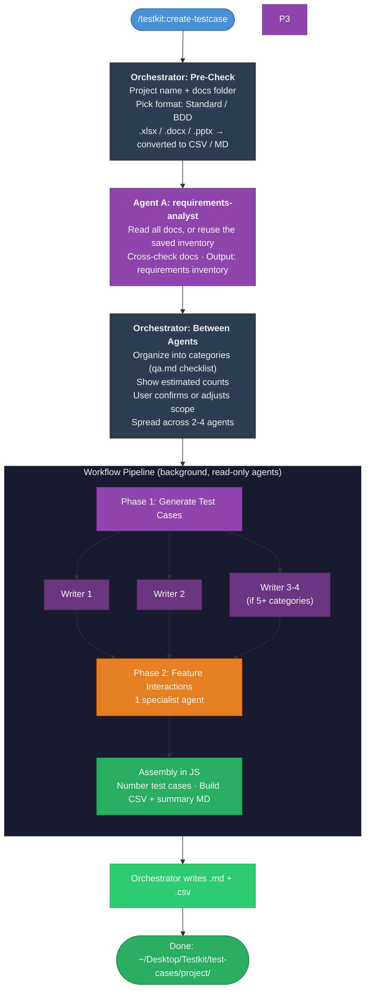

# /testkit:create-testcase

Generate positive, negative and edge test cases for any software feature from its reference documents: PRD, user stories, acceptance criteria, specs, API docs, design docs, business-rule tables and UI notes. The shared requirements-analyst reads and cross-checks the documents (or reuses what another skill already read), then 2-4 parallel agents write the test cases. The workflow numbers them and builds a Markdown summary and a generic CSV that works in any spreadsheet or test management tool.

## Install

This skill is part of the `testkit` plugin. See [Install](../../../../README.md#3-install) in the main README.

## Quick Start

```
/testkit:create-testcase
```

The skill walks you through the rest.

## Reading the requirements

The skill first asks for the **project name**, then finds the documents the same way as every testkit skill (see [Where everything is saved](../../../../README.md#where-everything-is-saved)). It saves what it read in `~/Desktop/Testkit/requirements/<project>/`: a cited requirements inventory, the list of source files, and readable copies of Office files. If you already ran `read-requirements` or `api-test-plan` for the same project and the documents haven't changed, it offers to reuse that instead of reading again. See [How they work together](../../../../README.md#testkit).

## Project rules (optional)

The skill works on any project out of the box. To add your project's specifics, see [Project rules](../../../../README.md#project-rules) in the main README. This skill uses:

- **Repos and folders**: default location of the requirements, and the output folder
- **Domain glossary and business rules**: to read the documents correctly and build edge cases
- **Units and formats**: how money, dates and IDs are written
- **Test case tags**: tags added to the CSV `Tags` column (none if not set)
- **Terminology and compliance**: approved wording for the test case text. Quoted UI text, messages and API names are never changed, so tests expect exactly what the product shows

Without project rules, the output says so.

## What It Does

You give it a project name and a folder of documents. The shared requirements-analyst reads them all (or it reuses the requirements already saved for that project) and checks them against each other for gaps and contradictions. You review the proposed categories and confirm the scope. The orchestrator then spreads the categories across 2-4 parallel agents by estimated size and launches a background workflow. It writes the test cases, runs a Feature Interactions specialist (if needed), numbers the test cases and builds the output files.

Default categories (only those the documents cover): Functional / Happy Path, Input Validation & Boundaries, Business Rules, State & Workflow Transitions, Permissions & Roles, Error Handling, Integrations, Data Persistence & Recovery, UI/UX & Accessibility, Localization & Formats, Performance Limits, Feature Interactions.

## What You Get

Two files in `~/Desktop/Testkit/test-cases/{project}/` (or your project rules output folder):

| File | Purpose |
|------|---------|
| `{project}-testcase-{format}.md` | Summary: feature overview, test case counts and clarification questions. The 10 questions with the most impact come first (ready to send to your product owner), each naming the test cases it affects (`TC-012 …`); the rest follow under "Other questions" |
| `{project}-testcase-{format}.csv` | All test cases, one per row (`TC-001`, `TC-002` …). A plain CSV with simple columns: open it in Excel or Google Sheets, or import it into any test management tool (TestRail, Zephyr, Xray, Qase …) |

`{format}` is `standard` or `bdd`, so you can tell the files apart without opening them, e.g. `orders-service-testcase-standard.csv` and `orders-service-testcase-bdd.csv`. Run the skill once per format to get both.

## Architecture

```
Orchestrator (main conversation)
│
├── Pre-Check
│   ├── Ask project name + docs path
│   ├── Validate files
│   └── Ask test case format (Standard / BDD)
│
├── Agent A: requirements-analyst (shared, or a reused inventory)
│   ├── Read all docs (Office files converted first)
│   ├── Extract flows, rules, API, UI, states, limits, errors, integrations
│   ├── Cross-check docs against each other
│   └── Output: requirements inventory, saved in ~/Desktop/Testkit/requirements/<project>/
│
├── Between Agents
│   ├── Organize into categories (qa.md checklist)
│   ├── Show summary with estimated counts
│   ├── Wait for user confirmation
│   └── Spread categories across 2-4 agents by weight
│
└── Workflow Pipeline (background, all agents read-only)
    │
    ├── Phase 1: Generate Test Cases
    │   └── 2-4 parallel writer agents → return content via schema
    │
    ├── Phase 2: Feature Interactions
    │   └── 1 specialist agent → return content via schema
    │
    ├── Assembly (JavaScript, no agents)
    │   └── Number the test cases, build the CSV and the summary MD
    │
    └── Orchestrator writes the final .md + .csv
```

## Flow



## Example Run

```
You:    /testkit:create-testcase
Claude: What's the project name?
You:    checkout-service
Claude: Last time checkout-service used these 4 files: checkout-prd.docx,
        user-stories.md, payments-api.yaml, discount-rules.xlsx. Use them again?
You:    Yes
Claude: Found the requirements for checkout-service from 3 Nov
        (4 files, unchanged). Reuse them?
You:    Yes
Claude: Which format? (1) Standard (2) BDD (Given/When/Then)
You:    2
Claude: 8 categories, ~70 test cases: Cart ~8, Discount Codes ~12, Payment ~14,
        Order Confirmation ~6, Input Validation ~10, Permissions & Roles ~6,
        Data Persistence & Recovery ~8, Feature Interactions ~6.
        Found 9 discrepancies (e.g. max quantity is 10 in the stories, 99 in
        the API doc). Confirm?
You:    Looks good, add more edge cases for discount codes
        [Workflow launches: 3 parallel writers + interactions specialist...]
Claude: Done. 74 test cases (TC-001 to TC-074) + 11 questions saved to
        ~/Desktop/Testkit/test-cases/checkout-service/
        checkout-service-testcase-bdd.csv and .md
        No project rules found, generic defaults used.
```

## Skill Structure

```
.../testkit/skills/create-testcase/
├── SKILL.md                      ← main skill definition (orchestrator + agent specs)
├── workflow.js                   ← workflow pipeline (Phase 1-2 + JS assembly)
├── README.md                     ← this file
├── references/
│   └── qa.md                     ← QA persona, terminology rule, coverage checklist, format specs
└── templates/
    ├── testcase.md               ← example of the summary .md
    ├── testcase-bdd.csv          ← CSV columns + examples, BDD format
    └── testcase-standard.csv     ← CSV columns + examples, Standard format
```

## Tips

- **More documents, better results.** A PRD plus stories, an API doc and rule tables give the requirements-analyst more to cross-check, so fewer gaps.
- **You control scope.** Between agents, you can skip categories, add new ones or ask for more coverage in one area.
- **The CSV works with any tool.** Columns are plain (`ID, Title, Type, Priority, Category, …, Tags, Source`). In your test management tool, map them once on import (e.g. `Expected Result` → the tool's expected-result field) and save the mapping.
- **Clarification questions are your review checklist.** Share them with product and engineering before testing starts.
- **Excel, Word and PowerPoint files are converted for you**: each `.xlsx` sheet becomes a CSV, each `.docx` and `.pptx` becomes Markdown, and the pictures inside them are saved as images. The copies are kept in `~/Desktop/Testkit/requirements/<project>/converted/` so the next run can reuse them; delete that folder when you no longer need it (for example for confidential documents). Your original files aren't changed. PDFs and images (screenshots, mockups, diagrams) are read as they are. Figma: export the frames as PNG or PDF first (see [Which files can I use?](../../../../README.md#which-files-can-i-use)). Old `.xls` / `.doc` / `.ppt` and password-protected files need saving in the newer format first.
- **No source code.** Test cases come only from the documents, so they test what was specified, not what was built.
